# Определение шахматных фигур и локализация на доске в реальном времени


Репозиторий содержит исследование, программный комплекс и обученные веса для детекции, классификации 12 типов шахматных фигур и их привязки к клеткам шахматной доски ($8 \times 8$, нотация a1–h8).

Я исследовал три архитектуры детекторов — **YOLOv11n**, **SSD300-VGG16** и **Faster R-CNN ResNet50-FPN**, создал гибридный датасет из **65 000+ изображений** (180 000 синтетических экземпляров + 50 000 физических кадров с автоматизированного поворотного стенда) и устранил разрыв доменов (domain gap) при переносе синтетических моделей на физические объекты.

---

## 1. Результаты

### Итоговая детекция на реальной доске (YOLOv11n)

На фотографии ниже приведен результат работы обученной модели YOLOv11n на физической доске с реальными фигурами при естественном освещении:

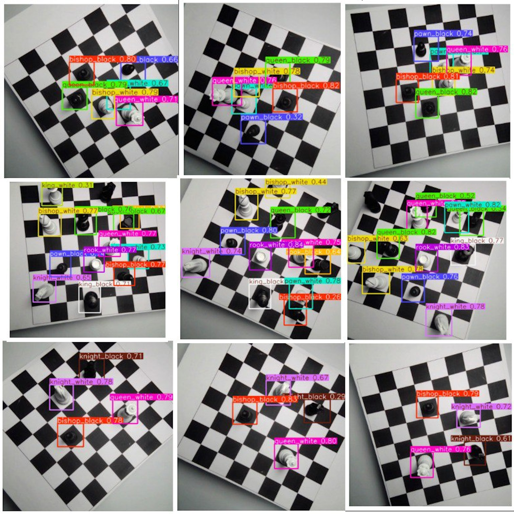

---

### Сравнительная таблица исследованных архитектур

Тестирование проводилось на отложенной выборке реальных физических фотографий. Вычисления выполнялись на GPU NVIDIA RTX (CUDA).

| Модель | Backbone | Число параметров | Размер весов | Время обучения | Скорость инференса (GPU) | Precision | Recall | $mAP_{50}$ | $mAP_{50-95}$ | Итоговый статус |
| :--- | :--- | :---: | :---: | :---: | :---: | :---: | :---: | :---: | :---: | :--- |
| **YOLOv11n** | Modified CSPDarknet | **2.6M** | **5.2 МБ** | **3 ч 58 мин** (74 эп.) | **2.3 мс (435 FPS)** | **0.8905** | **0.8906** | **0.8535** | **0.4074** | **Лучшая модель: высокий баланс скорости и точности, устойчива к бликам** |
| **SSD300** | VGG-16 | 24.0M | 90.0 МБ | 4 ч 15 мин (15 эп.) | 14.8 мс (67 FPS) | 0.8240 | 0.5410 | 0.5820 | 0.2410 | Недообучение: пропуски фигур при корректной классификации найденных |
| **Faster R-CNN** | ResNet-50 FPN | 41.5M | 165.9 МБ | 8 ч 09 мин (10 эп.) | 62.5 мс (16 FPS) | 0.8610 | 0.7130 | 0.7480 | 0.3520 | Переобучение на фоне, низкая скорость инференса |

---

### Ключевые инженерные выводы

1. **Разрыв между доменами (Domain Gap)**:
   Обучение детектора исключительно на синтетических 3D-рендерах дает сходимость на синтетическом валидационном сете ($mAP_{50} = 0.8217$, `box_loss` = 0.6109), но показывает нулевую обобщающую способность на реальных фотографиях ($0\%$ детекций). Причина — различия в спектре рассеяния света физического пластика, микрорельефе поверхности и оптических аберрациях линзы камеры.
2. **Предел эффективности синтетических аугментаций**:
   Применение комбинации аугментаций (Mosaic 4-way, Mixup $\alpha = 0.2$, HSV-jitter, геометрические аффинные трансформации) повысило устойчивость модели к масштабу, но не компенсировало отсутствие физических текстур. Для надежной работы потребовалось добавление реальных кадров в обучающую выборку.
3. **Ребалансировка функции потерь**:
   В шахматной задаче точное позиционирование ограничивающей рамки (IoU) достигается быстрее, чем разделение визуально схожих классов (ферзь против короля, пешка против слона). Я изменил веса компонент функции потерь в YOLOv11:
   - $\lambda_{\text{cls}} = 5.0$ (увеличен в 10 раз относительно стандартного $0.5$)
   - $\lambda_{\text{box}} = 1.5$ (снижен относительно стандартного $7.5$)
   - $\lambda_{\text{dfl}} = 1.0$

   Это устранило ошибки классификации между схожими фигурами одного цвета.
4. **Сравнение одностадийных и двухстадийных архитектур**:
   - Faster R-CNN требует малого размера батча (`batch_size = 4`) из-за потребления видеопамяти и не сходится за приемлемое время при аугментациях уровня Mosaic.
   - Одностадийная сеть YOLOv11n сошлась за 74 эпохи и обеспечила скорость $2.3$ мс на кадр, что позволяет развертывать ее на системах реального времени ($>400$ FPS).

---

## 2. Метрики и графики обучения

### Динамика обучения YOLOv11n (74 эпохи)

На графике представлены кривые потерь (Box Loss, Class Loss, DFL Loss) и динамика метрик Precision, Recall, $mAP_{50}$ и $mAP_{50-95}$ на тренировочной и валидационной выборках:

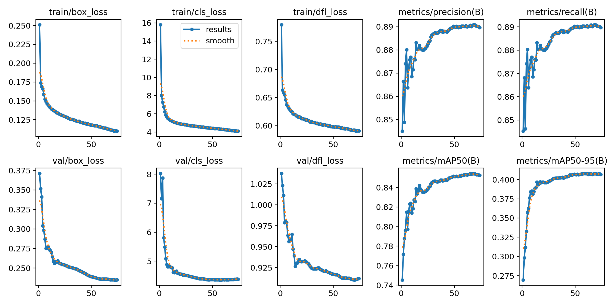

---

### Матрицы ошибок и кривые Precision-Recall

| YOLOv11n Confusion Matrix | YOLOv11n Precision-Recall Curve |
| :---: | :---: |
| 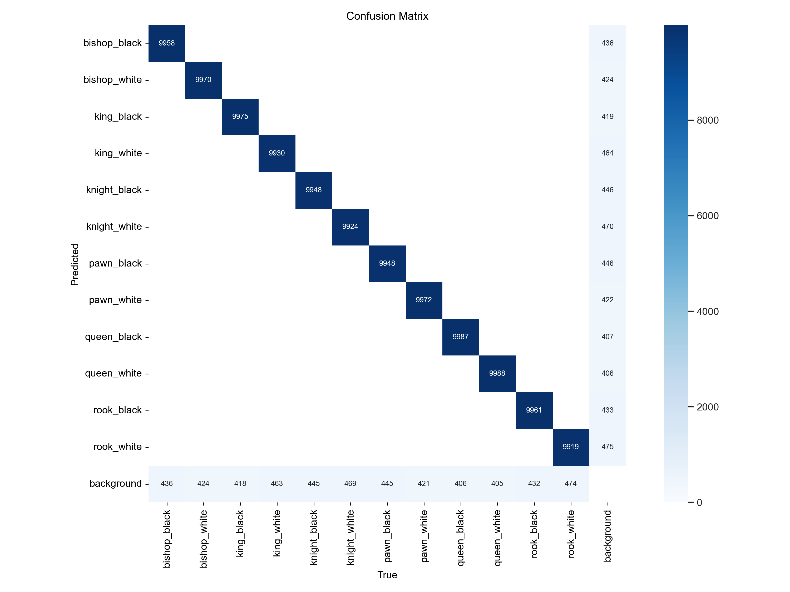 | 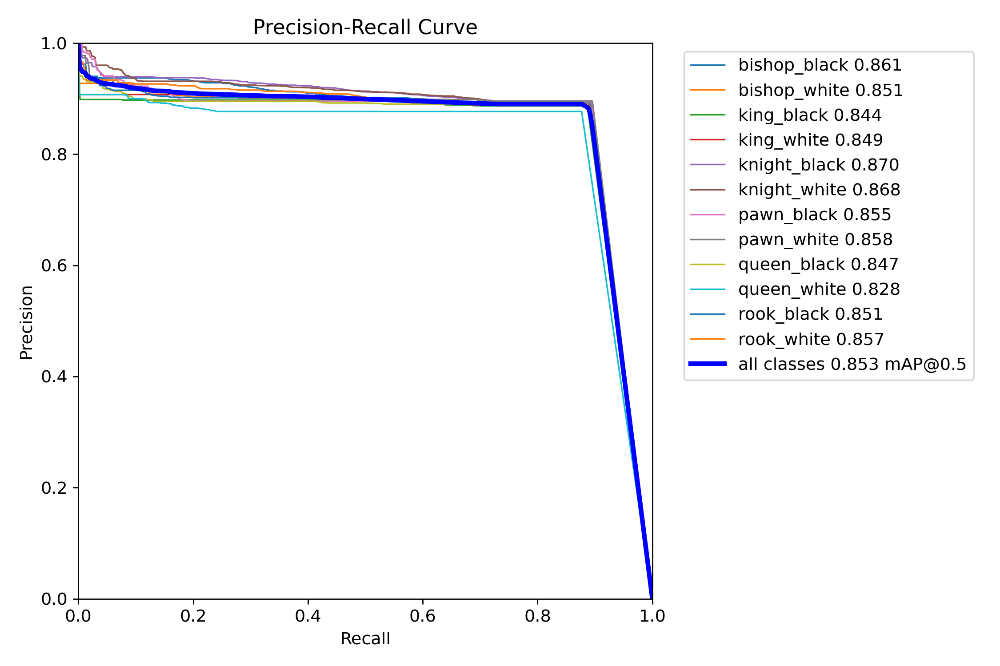 |

| SSD300 Confusion Matrix | Faster R-CNN Confusion Matrix |
| :---: | :---: |
| 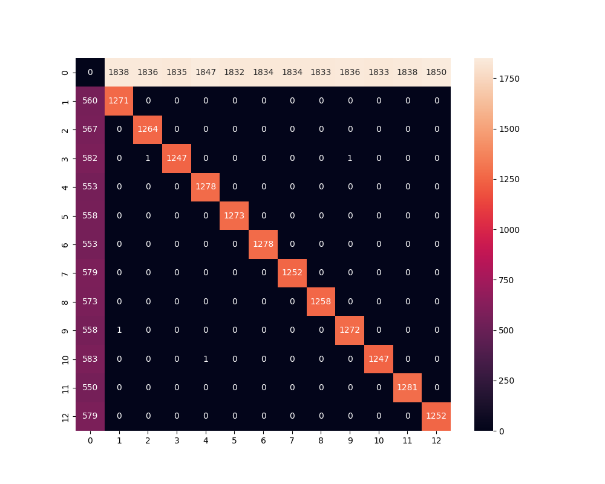 | 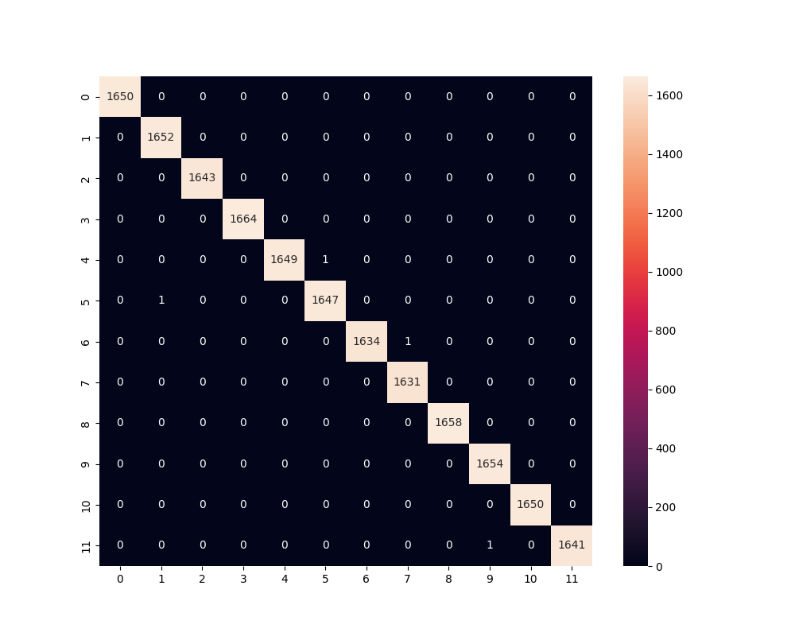 |

---

### Примеры работы SSD и Faster R-CNN

| SSD300-VGG16 (Пропуск объектов из-за недообучения) | Faster R-CNN ResNet50-FPN (Детекция с высокими порогами) |
| :---: | :---: |
| 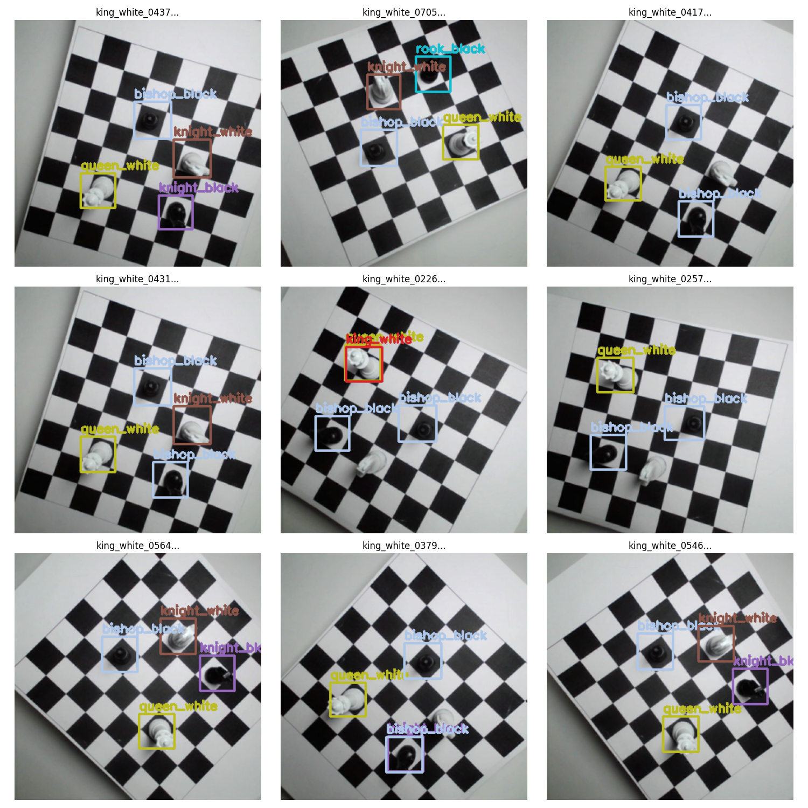 | 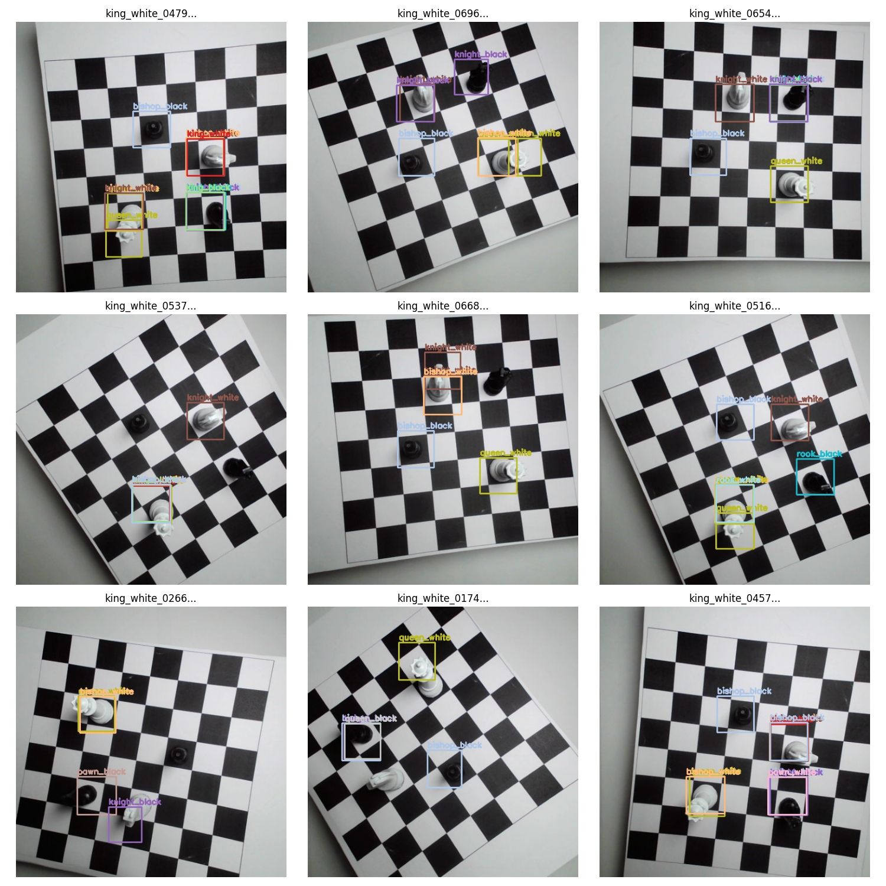 |

---

## 3. Постановка задачи и классы

Система решает задачу детекции объектов (Object Detection) и локализации их в дискретной сетке доски.

### Классы объектов (12 классов)

| ID | Имя класса | ID | Имя класса |
| :---: | :--- | :---: | :--- |
| `0` | `bishop_black` (черный слон) | `6` | `pawn_black` (черная пешка) |
| `1` | `bishop_white` (белый слон) | `7` | `pawn_white` (белая пешка) |
| `2` | `king_black` (черный король) | `8` | `queen_black` (черный ферзь) |
| `3` | `king_white` (белый король) | `9` | `queen_white` (белый ферзь) |
| `4` | `knight_black` (черный конь) | `10` | `rook_black` (черная ладья) |
| `5` | `knight_white` (белый конь) | `11` | `rook_white` (белая ладья) |

*Примечание: для моделей Torchvision (SSD, Faster R-CNN) нулевой индекс зарезервирован под фон (`background`), поэтому классы фигур сдвинуты на $+1$ (диапазон 1..12).*

---

## 4. Датасет: инженерия данных

Для обучения моделей я создал гибридный датасет, состоящий из двух независимых частей.

### 4.1. Синтетическая часть (Blender + Cycles CUDA)

Я написал процедурный скрипт для Blender ([`src/data/blender_generator.py`](src/data/blender_generator.py)), генерирующий 3D-сцены со случайной конфигурацией фигур.

| Синтетическая доска | Распределение фигур | 4-way Mosaic аугментация |
| :---: | :---: | :---: |
| 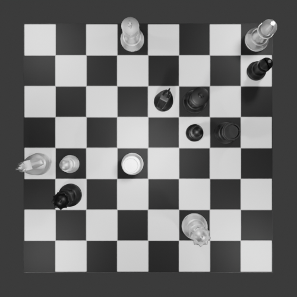 | 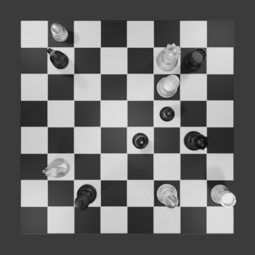 | 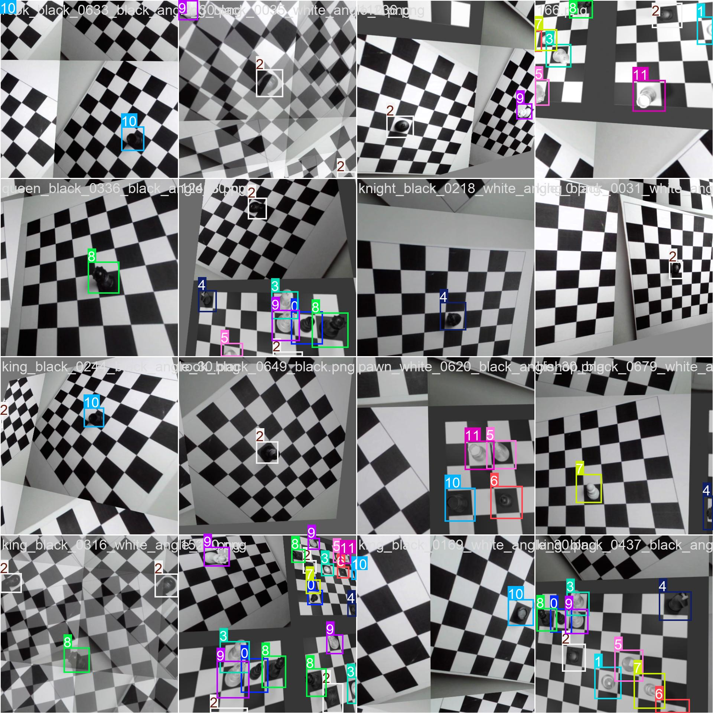 |

**Параметры генерации:**
- Объем выборки: **15 000 изображений** ($500 \times 500$ px), Cycles renderer, 32 сэмпла на пиксель.
- Общее число размеченных фигур: **180 000 объектов**.
- На доске процедурно размещаются до 12 уникальных фигур. Коллизии клеток исключены.
- Каждая фигура получает случайный угол вращения вокруг вертикальной оси: $\theta \sim \mathcal{U}(0, 2\pi)$.
- Освещение: 1 направленный источник (Sun) и 4 площадных источника (Area) мощностью по $1000$ Вт в углах сцены для устранения теней, перекрывающих соседние клетки.
- Камера: ортогональный вид сверху, координаты $(0, 0, 35)$.
- Автоматический расчет ограничивающей рамки:

$$
x_{\text{px}} = x_{\text{offset}} + (x_{\text{cell}} + 0.5) \cdot s_{\text{cell}}
$$

$$
y_{\text{px}} = s_{\text{img}} - (y_{\text{offset}} + (y_{\text{cell}} + 0.5) \cdot s_{\text{cell}})
$$

где $x_{\text{offset}} = y_{\text{offset}} = 40\text{ px}$, $s_{\text{cell}} = 52\text{ px}$, $s_{\text{img}} = 500\text{ px}$. Размер рамки: $70 \times 70\text{ px}$. Координаты нормируются на размер изображения в формат $[x_c, y_c, w, h] \in [0, 1]^4$.

---

### 4.2. Физическая часть: поворотный стенд и печать фигур

Для сбора реальных данных я распечатал фигуры на 3D-принтере и собрал специализированный стенд.

| Схема съемочного стенда | Фигуры после окраски | Захват одного образца |
| :---: | :---: | :---: |
| 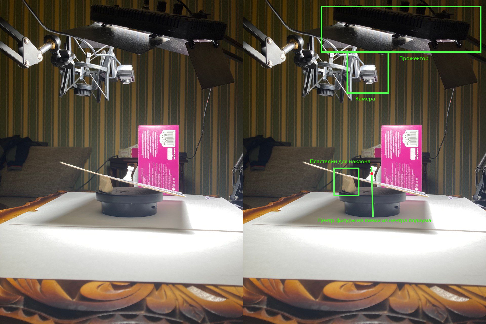 | 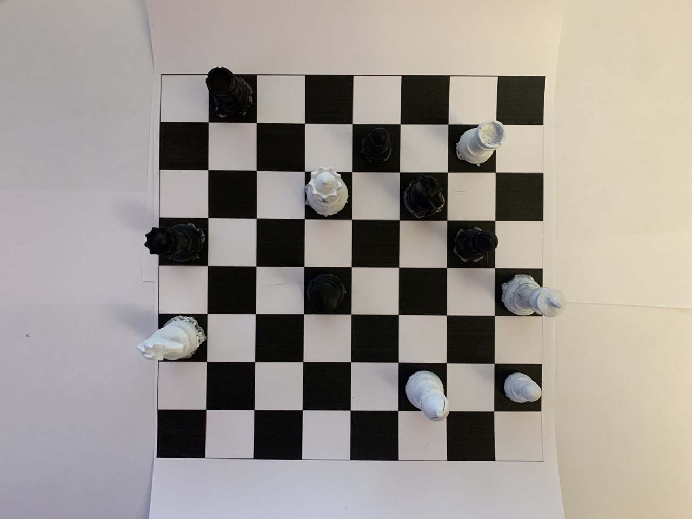 | 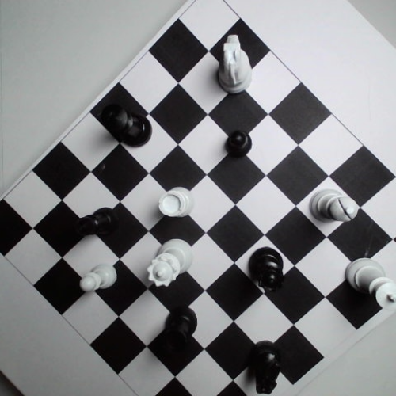 |

**Инженерные решения:**
1. **Борьба со слиянием с фоном**:
   Матовый пластик после 3D-печати поглощал свет и сливался с черными клетками доски. Я покрыл фигуры глянцевым металлизированным лаком с высоким коэффициентом зеркального отражения. Это создало четкие световые блики по контуру фигур, различимые сенсором камеры при любом угле падения света.
2. **Автоматизированная установка**:
   - Моторизованная поворотная платформа: $24$ секунды на полный оборот $360^\circ$.
   - Камера: 720p, частота $30$ кадров/с.
   - Съемка велась под 3 углами возвышения: $10^\circ, 20^\circ, 30^\circ$.
   - 2 типа подложки: белая клетка и черная клетка.
3. **Объем данных**:

$$
N = 30 \times 24 \times 12 \times 3 \times 2 = 51\,840
$$

   где:
   - $30$ — кадровая частота камеры (FPS);
   - $24$ — время полного оборота платформы (секунды);
   - $12$ — количество типов фигур;
   - $3$ — углы возвышения камеры ($10^\circ, 20^\circ, 30^\circ$);
   - $2$ — варианты контрастного фона (белая и черная клетка).
4. **Автоматическая разметка потока**:
   Скрипт [`src/data/video_collector.py`](src/data/video_collector.py) центрирует область интереса в квадрат $500 \times 500$ px. Фиксированная центрированная рамка $70 \times 70$ px позволила разметить 50 000 кадров без ручного труда.

---

## 5. Математический аппарат функций потерь

### 5.1. YOLOv11

Общая функция потерь:

$$
\mathcal{L}_{\text{YOLO}} = \lambda_{\text{box}} \mathcal{L}_{\text{CIoU}} + \lambda_{\text{cls}} \mathcal{L}_{\text{BCE}} + \lambda_{\text{dfl}} \mathcal{L}_{\text{DFL}}
$$

1. **Complete IoU Loss ($\mathcal{L}_{\text{CIoU}}$)**:

$$
\mathcal{L}_{\text{CIoU}} = 1 - \text{IoU} + \frac{\rho^2(b, b^{\text{gt}})}{c^2} + \alpha v
$$

   где $\rho(b, b^{\text{gt}})$ — евклидово расстояние между центрами рамок, $c$ — диагональ минимального описывающего прямоугольника,

$$
v = \frac{4}{\pi^2} \left( \arctan \frac{w^{\text{gt}}}{h^{\text{gt}}} - \arctan \frac{w}{h} \right)^2, \quad \alpha = \frac{v}{(1 - \text{IoU}) + v}
$$

2. **Binary Cross-Entropy Loss ($\mathcal{L}_{\text{BCE}}$)**:

$$
\mathcal{L}_{\text{BCE}} = - \sum_{i=1}^C \left[ y_i \log \hat{y}_i + (1 - y_i) \log(1 - \hat{y}_i) \right]
$$

3. **Distribution Focal Loss ($\mathcal{L}_{\text{DFL}}$)**:
   Оптимизирует вероятностное распределение вокруг целочисленных координат границы рамки для точного предсказания нежестких краев.

---

### 5.2. SSD300-VGG16

Функция потерь MultiBox:

$$
\mathcal{L}_{\text{SSD}}(x, c, l, g) = \frac{1}{N} \left( \mathcal{L}_{\text{conf}}(x, c) + \alpha \mathcal{L}_{\text{loc}}(x, l, g) \right)
$$

- $\mathcal{L}_{\text{loc}}$: гладкая $L_1$-регрессия (Smooth L1) между предсказанными смещениями рамок и априорными рамками (default boxes).
- $\mathcal{L}_{\text{conf}}$: Softmax по классам с Hard Negative Mining (соотношение отрицательных примеров к положительным фиксировано как $3:1$).
- При обучении со стандартным оптимизатором SGD возникала нестабильность градиентов; переход на AdamW (`lr = 1e-4`, `weight_decay = 5e-4`) стабилизировал сходимость.

---

### 5.3. Faster R-CNN ResNet50-FPN

Двухстадийная функция потерь:

$$
\mathcal{L}_{\text{FasterRCNN}} = \mathcal{L}_{\text{RPN-cls}} + \mathcal{L}_{\text{RPN-reg}} + \mathcal{L}_{\text{RoI-cls}} + \mathcal{L}_{\text{RoI-reg}}
$$

- Stage 1 (RPN): бинарная классификация наличия объекта и регрессия смещений предложений регионов (Region Proposals).
- Stage 2 (RoI Head): классификация по 13 классам и финальная регрессия координат рамки через операцию RoIAlign.

---

## 6. Архитектура проекта

```
Chess-piece-detection/
├── .gitignore                    # Исключения бинарных архивов, датасетов и кэша
├── LICENSE                       # MIT License
├── README.md                     # Документация проекта с результатами
├── requirements.txt              # Зависимости проекта
├── setup.py                      # Установка пакета в систему (pip install -e .)
├── configs/                      # Конфигурационные файлы
│   ├── yolo_chess.yaml           # Конфигурация классов и путей датасета YOLO
│   ├── yolo_hyp.yaml             # Кастомные гиперпараметры и веса потерь YOLO
│   ├── ssd_config.yaml           # Конфигурация обучения SSD300-VGG16
│   └── faster_rcnn_config.yaml   # Конфигурация обучения Faster R-CNN
├── src/                          # Исходный код модулей
│   ├── __init__.py
│   ├── constants.py              # Имена классов, ID, размеры доски и геометрия
│   ├── data/                     # Модули сбора и подготовки данных
│   │   ├── __init__.py
│   │   ├── blender_generator.py  # Процедурная генерация сцен в Blender (bpy)
│   │   ├── synthetic_annotator.py# Конвертация targets.csv в формат YOLO txt
│   │   ├── video_collector.py    # Захват кадров с реального поворотного стенда
│   │   └── torch_dataset.py      # PyTorch Dataset для SSD и Faster R-CNN
│   ├── models/                   # Архитектуры и тренировочные циклы
│   │   ├── __init__.py
│   │   ├── yolo_detector.py      # Класс-обертка для YOLOv11
│   │   ├── ssd_detector.py       # Модель SSD300-VGG16 и цикл обучения
│   │   └── faster_rcnn_detector.py# Faster R-CNN ResNet50-FPN и цикл обучения
│   ├── utils/                    # Вспомогательные математические модули
│   │   ├── __init__.py
│   │   ├── box_conversions.py    # Конвертация BBox (YOLO <-> VOC) и IoU
│   │   ├── metrics.py            # Расчет AP, mAP50, Confusion Matrix
│   │   └── visualization.py      # Отрисовка рамок с поддержкой Unicode-путей
│   └── inference/                # Инференс и интерпретация доски
│       ├── __init__.py
│       └── predict_board.py      # Детекция и привязка фигур к клеткам a1-h8
├── scripts/                      # Точки входа для CLI
│   ├── train_yolo.py             # Запуск обучения YOLOv11
│   ├── train_ssd.py              # Запуск обучения SSD
│   ├── train_faster_rcnn.py      # Запуск обучения Faster R-CNN
│   ├── predict.py                # Запуск детекции на произвольном изображении
│   └── verify_dataset.py         # Проверка разметки датасета
├── notebooks/                    # Исследовательские блокноты
│   └── chess_piece_detection_experiments.ipynb # Очищенный отчетный ноутбук
├── weights/                      # Веса обученных моделей
│   └── best.pt                   # Обученные веса YOLOv11n (5.2 МБ)
└── docs/                         # Документация и графические материалы
    ├── coursework_report.pdf     # Полный текст курсового проекта
    ├── presentation_kydysiuk_2026.pdf # Отчетный документ УНС 2026
    └── assets/                   # Извлеченные графики, матрицы ошибок и фото стенда
```

---

## 7. Инструкция по воспроизведению

### 7.1. Установка окружения

```bash
git clone https://github.com/kvdep/Chess-piece-detection.git
cd Chess-piece-detection

# Создание виртуального окружения
python -m venv venv
# Активация:
# Windows:
venv\Scripts\activate
# Linux/macOS:
source venv/bin/activate

# Установка зависимостей
pip install -r requirements.txt
pip install -e .
```

---

### 7.2. Запуск детекции (Inference)

Веса обученной модели YOLOv11n включены в репозиторий: [`weights/best.pt`](weights/best.pt).

Для запуска инференса на любом изображении:

```bash
python scripts/predict.py --image "docs/assets/real_single_piece_sample.png" --weights "weights/best.pt" --conf 0.25 --output "output_prediction.png"
```

Пример вывода в консоль:
```text
============================================================
Results for: docs/assets/real_single_piece_sample.png
Detected pieces count: 10
------------------------------------------------------------
Square [b3]: pawn_white     | Confidence: 0.778
Square [b4]: bishop_black   | Confidence: 0.627
Square [c6]: king_black     | Confidence: 0.776
Square [d3]: queen_white    | Confidence: 0.816
Square [d5]: rook_white     | Confidence: 0.799
Square [e6]: pawn_black     | Confidence: 0.686
Square [e8]: knight_white   | Confidence: 0.801
Square [f3]: queen_black    | Confidence: 0.810
Square [h4]: bishop_white   | Confidence: 0.731
============================================================
Annotated result successfully saved to: output_prediction.png
```

---

### 7.3. Генерация синтетического датасета в Blender

Для генерации 3D-сцен в фоновом режиме:

```bash
blender -b -P src/data/blender_generator.py -- \
    --model_dir "path/to/3d_models" \
    --output_dir "datasets/synthetic_raw" \
    --num_samples 15000 \
    --device CUDA
```

Конвертация полученного `targets.csv` в разметку формата YOLO:

```bash
python src/data/synthetic_annotator.py \
    --csv_path "datasets/synthetic_raw/targets.csv" \
    --images_dir "datasets/synthetic_raw" \
    --output_dir "datasets" \
    --val_percent 0.1
```

---

### 7.4. Захват физического датасета с поворотного стенда

Подключите камеру к стенду и запустите съемку нужной фигуры:

```bash
python src/data/video_collector.py \
    --piece "pawn" \
    --color "black" \
    --checkerboard "white" \
    --angle "10" \
    --camera_index 0
```
- Нажмите клавишу `s` в окне предпросмотра для запуска записи полного оборота (720 кадров).
- Скрипт сохранит центрированные кадры $500 \times 500$ px и сформирует файлы разметки `.txt`.

---

### 7.5. Обучение моделей

#### Обучение YOLOv11n
```bash
python scripts/train_yolo.py \
    --data configs/yolo_chess.yaml \
    --hyp configs/yolo_hyp.yaml \
    --model yolo11n.pt \
    --epochs 100 \
    --batch 8 \
    --imgsz 500
```

#### Обучение SSD300-VGG16
```bash
python scripts/train_ssd.py \
    --train_images datasets/images/train \
    --train_labels datasets/labels/train \
    --epochs 15 \
    --batch_size 8 \
    --lr 0.0001
```

#### Обучение Faster R-CNN ResNet50-FPN
```bash
python scripts/train_faster_rcnn.py \
    --train_images datasets/images/train \
    --train_labels datasets/labels/train \
    --epochs 10 \
    --batch_size 4 \
    --lr 0.0001
```

---

### 7.6. Запуск модульных тестов

```bash
python -m unittest discover tests
```

---

## 8. Лицензия

Проект распространяется под лицензией [MIT](LICENSE).
Автор: [Александр Кидысюк (kvdep)](https://github.com/kvdep).
